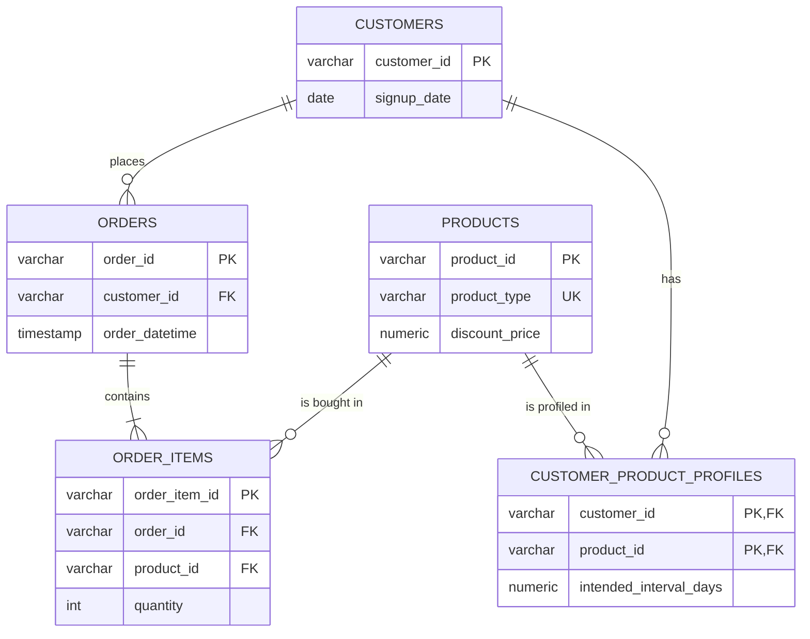

# maf_firstproject

## Smart Reorder & Subscription Shopping: Recommendation System

This repository holds the recommendation-system part of the *Smart Reorder &
Subscription Shopping* internship project. The product will recommend *when* a
customer should reorder everyday products they buy repeatedly (milk, rice,
toothpaste, ...) and support subscriptions for them. The work so far builds the
data foundation for that recommender:

- **Phase 1: catalogue preprocessing.** Turns a large product catalogue into a
  small, curated, reproducible set of 20 everyday products with different
  replenishment patterns, such as daily milk, weekly vegetables, monthly rice,
  and personal-care and cleaning items.
- **Phase 2: synthetic transactions.** Generates a reproducible 180-day purchase
  history for 100 synthetic customers buying those 20 products (see
  [Phase 2](#phase-2-synthetic-transaction-data)).
- **Phase 3: PostgreSQL integration.** Loads all five datasets
  into a validated relational schema (SQLAlchemy models, constraints, a
  transactional and repeatable loader, and a validator). See
  [Phase 3](#phase-3-postgresql-database-integration).
- **Phase 4: recommendation engine and API (current phase).** A framework-independent
  engine that ranks each customer's replenishment needs, plus a FastAPI service that
  exposes it to the React frontend. It runs next to the teammate's Flask app
  (subscriptions and WhatsApp notifications). See
  [Phase 4](#phase-4-recommendation-engine-and-fastapi).

The subscription and notification module (Flask, `app/`) is developed separately; see
`docs/SUBSCRIPTIONS_CONTEXT.md`. There is no frontend in this repository yet.

---

## Dataset

**Source:** `BigBasket.csv`, a scrape of the BigBasket (Indian online grocery) product catalogue.
It has 8,208 rows, one row per SKU, and these 9 columns:

| Column | Meaning |
|---|---|
| `ProductName` | Product title as listed (often includes marketing text) |
| `Brand` | Brand name |
| `Price` | MRP in INR |
| `DiscountPrice` | Selling price in INR |
| `Image_Url` | Product image |
| `Quantity` | **Pack size of the SKU** (e.g. `500 ml`, `2x100 g`, `Combo`) |
| `Category` | Top-level category (11 values) |
| `SubCategory` | Sub-category (334 values) |
| `Absolute_Url` | Product page; contains the numeric SKU id (`/pd/<sku_id>/...`) |

### Why this is a catalogue, not purchase history

The dataset describes **what can be bought**, not **what anyone bought**:

- There are no customer IDs, order IDs or purchase timestamps.
- `Quantity` is the size of the pack on the shelf (for example, "1 kg of rice").
  It is **not** how many units a customer ordered. The pipeline keeps it as
  `pack_size` metadata and parses it into `pack_count`, `pack_unit_size` and `pack_unit`.
- The same product appears several times as different pack sizes or brands
  (1,439 repeated product names), and each of those rows is a separate SKU.

Phase 1 therefore creates no purchase histories. Phase 2 simulates them separately,
in `data/synthetic/`.

---

## Project structure

```
maf/                               <- project root (the existing workspace)
├── BigBasket.csv                  <- original catalogue, used in place and never modified
├── .env.example                   <- template for database settings (copy to .env)
├── .env                           <- your local database credentials (git-ignored)
├── config/
│   ├── product_selection.json     <- Phase 1: target product types, matching rules, manual overrides
│   └── synthetic_config.json      <- Phase 2: seed, window, product cycles, customer segments
├── data/
│   ├── raw/README.md              <- explains where the raw CSV lives
│   ├── processed/
│   │   ├── selected_products.csv
│   │   ├── selected_products.json
│   │   └── product_selection_report.md
│   └── synthetic/                 <- Phase 2 output (all synthetic)
│       ├── customers.csv
│       ├── orders.csv
│       ├── order_items.csv
│       ├── customer_product_profiles.csv
│       └── synthetic_data_report.md
├── database/                      <- Phase 3: PostgreSQL layer
│   ├── __init__.py
│   ├── connection.py              <- engine, sessions, .env loading, connectivity check
│   ├── models.py                  <- SQLAlchemy ORM models for the 5 tables
│   └── sources.py                 <- CSV -> table mapping and strict validation
├── app/                           <- Flask app: subscriptions, orders, WhatsApp (teammate's module)
├── run.py                         <- Flask entry point
├── recommendation_engine/         <- Phase 4: recommendation logic (no web framework)
├── recommendation_api/            <- Phase 4: FastAPI HTTP layer for the engine
├── docs/SUBSCRIPTIONS_CONTEXT.md  <- subscription module context
├── scripts/
│   ├── run_recommendations.py     <- Phase 4: run the engine from the terminal
│   ├── inspect_dataset.py         <- explore and search the catalogue
│   ├── preprocess_catalogue.py    <- Phase 1: selection, cleaning, validation and export
│   ├── generate_synthetic_transactions.py  <- Phase 2: synthetic customers and orders
│   ├── create_database.py         <- Phase 3: create tables (non-destructive)
│   ├── load_data.py               <- Phase 3: transactional CSV -> PostgreSQL load
│   └── validate_database.py       <- Phase 3: PASS/WARNING/FAIL integrity report
├── tests/
│   ├── conftest.py
│   ├── test_preprocess_catalogue.py
│   ├── test_synthetic_data.py
│   ├── test_database_schema.py    <- Phase 3, no database needed
│   └── test_database_integration.py  <- Phase 3, needs TEST_DATABASE_URL
├── requirements.txt
└── README.md
```

The workspace already had the CSV at its root, so the root itself is the project
folder. This avoids an extra `recommendation-system/` level and a second copy of
the 2.7 MB CSV. To move the CSV into `data/raw/`, see `data/raw/README.md`.

---

## Setup

Requires Python 3.10 or later. Run all commands from the project root.

**Windows (PowerShell)**

```powershell
python -m venv .venv
.\.venv\Scripts\Activate.ps1
# If activation is blocked: Set-ExecutionPolicy -Scope CurrentUser RemoteSigned
python -m pip install --upgrade pip
pip install -r requirements.txt
```

**Linux / macOS**

```bash
python3 -m venv .venv
source .venv/bin/activate
python -m pip install --upgrade pip
pip install -r requirements.txt
```

Dependencies: `pandas`, `numpy`, `SQLAlchemy`, `psycopg[binary]` (PostgreSQL driver), `python-dotenv` and `pytest`.

---

## Inspect the dataset

```powershell
python scripts/inspect_dataset.py                          # full overview
python scripts/inspect_dataset.py --top 0                  # include all 334 subcategories
python scripts/inspect_dataset.py --search toothpaste      # keyword search
python scripts/inspect_dataset.py -s "sona masoori" -s atta --limit 10 --no-overview
python scripts/inspect_dataset.py --subcategory "Curd" --no-overview
```

The overview shows the shape, columns and dtypes, missing values, duplicates,
unique product, brand and category counts, category and subcategory counts, price
statistics, common pack sizes and sample products. A search matches every word
against the name, brand and subcategory. Each result row shows the **SKU id**,
which you need for manual overrides.

---

## Run the preprocessing

```powershell
python scripts/preprocess_catalogue.py
```

Optional flags: `--config <path>`, `--input <csv>`, `--output-dir <dir>`.

What it does:

1. Records the SHA-256 of the source CSV.
2. For each target in `config/product_selection.json`, it selects **one** SKU in this order:
   1. `manual_sku_id`, if one is set
   2. the best match from the `match` rules
   3. the `fallback` rules, if any; the result is flagged as a substitute
   4. otherwise, the type is reported as **missing**
3. Cleans names and brands (the originals are kept), converts prices to numbers,
   parses pack sizes and builds a stable `product_id`.
4. Validates the result and fails with a readable error message if any check fails.
5. Writes the three files to `data/processed/` and verifies the CSV checksum is unchanged.

The output is deterministic: running it again with the same config produces
byte-identical files. A test checks this.

### Output fields

| Field | Description |
|---|---|
| `product_id` | `bb-<sku_id>`, from the BigBasket SKU in the product URL. If a URL had no SKU, it would be `bbh-<sha1 of brand, name and pack>`. It never depends on the row number. |
| `sku_id` | Numeric BigBasket SKU |
| `product_type` | Curated type (`milk`, `shampoo`, `rice`, ...) |
| `product_name` / `original_product_name` | Cleaned display name / exact name from the CSV |
| `brand` / `original_brand` | Cleaned brand (via `brand_aliases`) / exact brand from the CSV |
| `price` / `discount_price` | MRP / selling price (float, INR) |
| `pack_size` | Raw catalogue `Quantity` (pack size, not a purchase quantity) |
| `pack_count`, `pack_unit_size`, `pack_unit` | Parsed pack size, e.g. `2x100 g` gives `2`, `100.0`, `g` |
| `category`, `subcategory`, `image_url`, `product_url` | Copied unchanged from the CSV |
| `replenishable` | Boolean |
| `consumption_pattern` | Descriptive label from the config (e.g. `daily_perishable`, `monthly_staple`). It is not used by any algorithm yet. |
| `selection_method` | `auto`, `manual_override` or `fallback` |
| `source_row_number` | Row position in the CSV, kept for traceability only |

### Validation checks

- No more than `max_products` (20) products
- `product_id` values are unique, and no SKU is used twice
- `product_type` values are unique, unless `allow_duplicate_product_types` is `true`
- All required output columns are present
- Prices are numeric and present
- Every selected row exists in the CSV, and its name, brand, image, pack size,
  category, subcategory and prices match the source exactly
- Image and product URLs are kept
- Missing target types are reported in the console and the report
- The source CSV checksum is identical before and after the run

---

## Run the tests

```powershell
pytest            # or: python -m pytest -v
```

`tests/test_preprocess_catalogue.py` (Phase 1) checks: unique IDs, a count of
20 or fewer, that output files exist, required columns, numeric prices, a Boolean
`replenishable`, that rows come from the source CSV, determinism, that the
original CSV is unchanged, pack-size and price parsing, ID generation, manual
overrides, missing-type reporting and that validation fails on bad input.

`tests/test_synthetic_data.py` (Phase 2) is described in
[Phase 2](#phase-2-synthetic-transaction-data). The database tests are described in
[Phase 3](#database-tests).

The PostgreSQL integration tests are **skipped** unless `TEST_DATABASE_URL` points
to a reachable test database; everything else runs without a database.

---

## Modifying product selections

Edit **`config/product_selection.json`**. You never need to edit the scripts.

**Replace one product with a specific SKU (simplest):**

1. Find the SKU: `python scripts/inspect_dataset.py -s "head shoulders" --no-overview` (for example, SKU `307917` is Head & Shoulders Anti-Hairfall 340 ml).
   You can also use the *Alternatives per product type* tables in
   `data/processed/product_selection_report.md`.
2. Set it on the target:
   ```json
   { "product_type": "shampoo", "manual_sku_id": "307917", ... }
   ```
3. Re-run `python scripts/preprocess_catalogue.py`, then `pytest`.

Set `manual_sku_id` back to `null` to return to rule-based matching.

**Tune the matching rules.** Each target's `match` block supports these keys:

| Key | Effect |
|---|---|
| `categories`, `subcategories` | Restrict candidates; the order of `subcategories` is also a preference |
| `name_include_any` | Regex list; the name must match at least one |
| `name_exclude_any` | Regex list; the name must match none |
| `preferred_brands` | Ordered preference |
| `preferred_name_patterns` | Ordered regex preference, e.g. pick "Daily Shine" among Dove shampoos |
| `preferred_pack_sizes` | Ordered preference, e.g. `["500 ml", "1 L"]`; spaces and case are ignored |

Candidates are ranked by complete data, then brand, then name pattern, then pack
size, then subcategory, then lower price, then lower SKU id. Rows whose pack size
is `Combo`, or whose name looks like a bundle (`... + ...`), are excluded globally.

**Other knobs:**

- `fallback`: a substitute match with a `reason`, used only when the primary rules find nothing.
- `display_name_overrides`: SKU id → clean display name. It is keyed by SKU, so it
  cannot leak onto a different product after a swap.
- `brand_aliases`: raw brand → cleaned brand.
- To add or remove a product type, add or delete an entry in `targets`. The total
  must stay at 20 or fewer.

---

## Interpreting the selected products

Open `data/processed/product_selection_report.md`. It lists:

- the selected products (ID, name, brand, pack size, prices, category and subcategory, URL)
- coverage for each target type: matched, matched via manual override, substitute, or missing
- substitutes, manual overrides and matching uncertainties, such as ties, a
  non-preferred brand or pack size, or a fallback
- the top alternative SKUs for each type, so you can swap quickly

The `consumption_pattern` labels group the 20 products by how often a household
typically restocks them:

| Pattern | Products |
|---|---|
| `daily_perishable` | milk, bread (rusk substitute), eggs, curd |
| `chilled_dairy` | butter |
| `fresh_produce` | onion, potato, tomato |
| `monthly_staple` | rice, atta, cooking oil, tea, coffee |
| `pantry_snack` | biscuits, instant noodles |
| `personal_care` | shampoo, toothpaste, bathing soap |
| `household_cleaning` | detergent, dishwashing liquid |

These labels describe the products. They are not replenishment intervals; those
will be learned or modelled in a later phase.

### Known data caveats

- **Bread:** the catalogue has no sliced or loaf bread. A milk rusk is used as a
  flagged substitute, but it has a much longer shelf life than bread. To drop bread
  instead, set the bread target's `fallback` to `null`.
- Some catalogue prices look wrong (e.g. a 70 g Maggi listed at ₹156, a 125 g Dove
  bar at ₹401). The selection rules avoid these rows, but keep them in mind when
  swapping SKUs.

---

## Phase 2: synthetic transaction data

The catalogue contains no purchases, so Phase 2 simulates a **reproducible**
purchase history for testing a future replenishment recommender. All customers
and orders are synthetic. Phase 2 reads `data/processed/selected_products.csv`
and never modifies it; the generator checks its checksum before and after each run.

### Generate

```powershell
python scripts/generate_synthetic_transactions.py                 # uses config/synthetic_config.json
python scripts/generate_synthetic_transactions.py --seed 7        # a different, still reproducible dataset
python scripts/generate_synthetic_transactions.py --customers 300 --output-dir data/synthetic_300
```

The same seed, config and catalogue always produce byte-identical files.

### Output files (`data/synthetic/`)

| File | One row per | Columns |
|---|---|---|
| `customers.csv` | synthetic customer | `customer_id`, `signup_date`, `behaviour_segment`, `household_size`, `preferred_weekday` |
| `orders.csv` | purchase occasion (shopping trip) | `order_id`, `customer_id`, `order_date`, `order_datetime`, `item_count`, `unit_count`, `order_total` |
| `order_items.csv` | product within an order | `order_item_id`, `order_id`, `product_id`, `product_type`, `quantity`, `unit_price`, `line_total` |
| `customer_product_profiles.csv` | customer × product the customer buys | the generator's intended interval and quantity, active period, late-adopter and dropped-out flags |
| `synthetic_data_report.md` | | assumptions and statistics |

**Quantity is separate from frequency.** `quantity` is the number of catalogue
packs bought in that order (e.g. 3 × 500 ml milk). Buying 5 units is one purchase
occasion: one `order_items` row with `quantity = 5`. A product appears at most
once per order, and a customer has at most one order per day.

`behaviour_segment` and `customer_product_profiles.csv` are **ground truth** for
evaluating a future algorithm. A real system would not have them, so do not use
them as model inputs.

### How the data is simulated

1. **Product cycles.** Each `product_type` has a base interval and base quantity
   for a 3-person household (`product_profiles` in the config). For example, milk
   is every 2 days and 2 packs, tomato every 4 days, rice every 30 days, shampoo
   every 40 days, and detergent every 35 days. Product IDs and prices are looked up
   from the catalogue by `product_type`. None are hardcoded, and the config is
   rejected if its types don't match the catalogue.
2. **Customer segments** (100 customers):

   | Segment | Count | Behaviour |
   |---|---:|---|
   | `regular` | 20 | Frequent, fairly regular buyers of many products |
   | `weekly` | 18 | One trip a week on a preferred weekday; buys weekly quantities |
   | `bulk` | 12 | Intervals ×2.5, with proportionally larger quantities |
   | `irregular` | 15 | Long, highly variable gaps; 30% of purchase occasions skipped |
   | `new` | 12 | Signed up 7–45 days before the end date, so little history |
   | `lapsed` | 10 | Regular history that stops 30–80 days before the end date |
   | `basket_consolidator` | 13 | Merges purchases within 5 days into large multi-product orders |

3. **Each customer** gets a household size (which scales quantities), a random
   subset of products (weighted by each product's `adoption`), and a personal
   interval for each product (base × segment multiplier × lognormal noise).
   Quantity grows with the interval, so consumption stays plausible.
4. **Imperfections.** Every gap gets lognormal noise, and some purchase occasions
   are skipped. About 25% of customers take a 6–16 day break, about 8% of products
   are dropped mid-history, and about 8% are adopted late.
5. **Orders.** A customer's product purchases within the segment's
   `order_window_days` are grouped into one order (a shopping trip), with a
   realistic time of day. `unit_price` is the catalogue `discount_price`.
6. **Validation** runs before any file is written: valid customer, order and
   product IDs, positive integer quantities, valid dates inside the window and
   not before signup, no duplicate (order, product) rows, and order totals and
   item counts that match the items.

**Not modelled:** seasonality, promotions, price changes, stock-outs, returns,
and switching between brands. **Bread** is the Phase 1 rusk substitute, but it
is simulated with a frequent, bread-like cycle as specified.

### Phase 2 tests

`tests/test_synthetic_data.py` checks:
- referential integrity: customer, order and catalogue product IDs
- positive quantities and valid dates
- no duplicate product within an order
- reproducibility with the same seed, and different data with a different seed
- that the catalogue is unchanged and `data/synthetic/` matches the current config
- realism: all segments present, different product subsets per customer,
  multi-product orders, fast products bought more often than slow ones, gaps that
  are not perfectly periodic, lapsed customers who stop, and weekly buyers who
  keep to their weekday
- that the test scenarios are present: recently purchased, not yet due, overdue,
  insufficient history, inconsistent history, and customers with no recent purchases
- that the validator rejects deliberately corrupted data

**After changing `config/synthetic_config.json`, re-run the generator.** A test
fails if `data/synthetic/` is out of date.

---

## Phase 3: PostgreSQL database integration

This phase loads the five existing CSV datasets into PostgreSQL with a validated
relational schema. The CSVs stay where they are and are only read, never modified.
The loader re-hashes them after each load to prove this.

### The five datasets

| Table | Source CSV | Rows | Grain |
|---|---|---:|---|
| `products` | `data/processed/selected_products.csv` | 20 | one curated SKU per product type |
| `customers` | `data/synthetic/customers.csv` | 100 | synthetic customer |
| `orders` | `data/synthetic/orders.csv` | 4,075 | purchase occasion (shopping trip) |
| `order_items` | `data/synthetic/order_items.csv` | 12,494 | one product within one order |
| `customer_product_profiles` | `data/synthetic/customer_product_profiles.csv` | 964 | generator ground truth per (customer, product) |

The table columns are exactly the CSV columns. Nothing is invented or dropped, and
a test enforces this:

| Table | Columns (PostgreSQL type) |
|---|---|
| `products` | **product_id** varchar(32), sku_id bigint UNIQUE, product_type varchar(50) UNIQUE, product_name text, original_product_name text, brand, original_brand varchar(100), price numeric(10,2), discount_price numeric(10,2), pack_size varchar(50), pack_count int NULL, pack_unit_size numeric(10,3) NULL, pack_unit varchar(10) NULL, category, subcategory varchar(100), image_url text, product_url text UNIQUE, replenishable boolean, consumption_pattern varchar(50) NULL, selection_method varchar(20), source_row_number int |
| `customers` | **customer_id** varchar(20), signup_date date, behaviour_segment varchar(30), household_size smallint, preferred_weekday varchar(3) |
| `orders` | **order_id** varchar(20), customer_id → customers, order_date date, order_datetime timestamp (no time zone, as in the source), item_count int, unit_count int, order_total numeric(12,2) |
| `order_items` | **order_item_id** varchar(20), order_id → orders, product_id → products, product_type varchar(50), quantity int, unit_price numeric(10,2), line_total numeric(12,2) |
| `customer_product_profiles` | **(customer_id → customers, product_id → products)**, product_type varchar(50), intended_interval_days numeric(7,1), intended_mean_quantity numeric(8,2), active_from date, active_until date, late_adopter boolean, dropped_out boolean, purchase_occasions int |

Columns are `NOT NULL` except the ones marked `NULL`. Money uses exact `NUMERIC`,
never floating point.

### Relationships



**Integrity enforced by PostgreSQL itself, not just by the loader:**

- **Foreign keys** (`ON DELETE RESTRICT`): orders → customers; order_items → orders
  and products; profiles → customers and products.
- **Composite foreign keys** `(product_id, product_type) → products(product_id, product_type)`
  on `order_items` and profiles. The denormalised `product_type` copied from the
  CSVs can never disagree with the catalogue.
- **Uniqueness:** one row per product within an order `(order_id, product_id)`, and
  one profile per `(customer_id, product_id)` (this is the primary key). In
  products, `sku_id`, `product_type` and `product_url` are each unique.
- **Check constraints:**
  - quantity > 0
  - line_total = quantity × unit_price
  - 0 < discount_price ≤ price
  - order_date = date(order_datetime)
  - item_count > 0 and unit_count ≥ item_count
  - active_from ≤ active_until
  - household_size > 0
  - preferred_weekday is Mon–Sun
  - selection_method is auto, manual_override or fallback
  - non-negative purchase_occasions
- **Indexes** for purchase-history access: `orders(customer_id, order_date)`,
  `orders(order_date)`, `order_items(product_id)` and
  `customer_product_profiles(product_id)`. Primary keys and unique constraints
  index the other lookups.

Things that are true in the synthetic data but deliberately **not** enforced as
constraints, because real data may break them: one order per customer per day,
unit_price equal to the catalogue price, and orders on or after signup. The
validator reports these instead.

### PostgreSQL setup

> **Working as a team?** The shared database lives on Supabase; see
> [Shared team database (Supabase)](#shared-team-database-supabase). A local
> PostgreSQL (below) is optional, and is only needed to run the database integration
> tests or to work offline.

1. **Install PostgreSQL** (version 14 or later):
   - Windows: use the installer from https://www.postgresql.org/download/windows/
     (includes `psql` and pgAdmin). Remember the password you set for the `postgres` user.
   - macOS (Homebrew; this is the setup used for this project): `brew install postgresql@18`
     then `brew services start postgresql@18`. Homebrew creates a superuser named
     after your macOS account and allows passwordless (`trust`) connections from
     localhost only. The binaries are not on PATH by default; add
     `export PATH="/opt/homebrew/opt/postgresql@18/bin:$PATH"` to `~/.zshrc` to use `psql` by name.
     The project connects as a dedicated non-superuser role that owns both databases:
     ```bash
     psql -h localhost -d postgres -c "CREATE ROLE rec_app LOGIN PASSWORD '<password>';"
     createdb -h localhost -O rec_app recommendation_db
     createdb -h localhost -O rec_app recommendation_db_test
     ```
   - Linux (Debian/Ubuntu): `sudo apt install postgresql`
   - Or Docker: `docker run --name rec-pg -e POSTGRES_PASSWORD=<password> -p 5432:5432 -d postgres:16`
2. **Create the two databases.** The test database keeps tests away from your data:
   ```powershell
   psql -U postgres -h localhost -c "CREATE DATABASE recommendation_db;"
   psql -U postgres -h localhost -c "CREATE DATABASE recommendation_db_test;"
   ```
   Or let the script create the main one: `python scripts/create_database.py --create-db`.
3. **Configure credentials.** Copy the template and edit the passwords:
   ```powershell
   Copy-Item .env.example .env      # Windows PowerShell
   ```
   ```bash
   cp .env.example .env             # Linux / macOS
   ```
   ```ini
   DATABASE_URL=postgresql+psycopg://postgres:<password>@localhost:5432/recommendation_db
   TEST_DATABASE_URL=postgresql+psycopg://postgres:<password>@localhost:5432/recommendation_db_test
   ```
   - `.env` is git-ignored. Real environment variables take precedence over `.env`.
   - URL-encode special characters in passwords (`@` → `%40`, `:` → `%3A`).
   - No credentials appear in the source code, and a test checks this.
   - Log output always masks the password.

### Run it

After the [Python setup](#setup), run these from the project root. The commands
work the same in PowerShell and bash.

```powershell
python scripts/create_database.py --check   # test connectivity; show which tables exist
python scripts/create_database.py           # create missing tables (never drops/alters)
python scripts/load_data.py --dry-run       # validate the 5 CSVs without touching the database
python scripts/load_data.py                 # first load into empty tables
python scripts/validate_database.py         # PASS / WARNING / FAIL report
python scripts/validate_database.py --report data/database_validation_report.md
pytest                                      # all tests (DB tests need TEST_DATABASE_URL)
```

- **Reload after regenerating data:** `python scripts/load_data.py --replace`, then validate again.
- **Inspect data:** use `python scripts/inspect_dataset.py` (raw catalogue). For
  the synthetic data, read `data/synthetic/synthetic_data_report.md`. In the
  database, use `psql "<DATABASE_URL without +psycopg>"` or pgAdmin.

### Data import strategy

`load_data.py` uses a **transactional full refresh**:

1. **Validate first, outside the database.** All five CSVs are read as text and
   converted strictly:
   - no silent coercion or rounding (e.g. `1.234` into `numeric(10,2)` is an error)
   - required columns present, and no unexpected extra columns (which would be dropped silently)
   - types, NOT NULL, primary and unique keys, every foreign key (including the
     product_type pairs) and the business rules

   Every problem is listed at once, and nothing touches the database until the
   CSVs are clean.
2. **One transaction:**
   - Lock the five tables, so concurrent loads can't interleave.
   - Count the existing rows. If any table has data, the load **stops and changes
     nothing** unless you passed `--replace`. With `--replace`, it deletes the rows
     in reverse dependency order *inside the same transaction* and prints what it is
     replacing.
   - Insert in dependency order: products → customers → orders → order_items → profiles.
   - Verify the row counts and re-hash the source files.
   - Commit.
3. **Any error rolls back everything**, whether a constraint violation, a lost
   connection or a count mismatch. The database is never left partially loaded,
   and the previous data survives a failed `--replace`.

The result is **idempotent**: running `--replace` any number of times produces an
identical database. Upserts were not used because the CSVs are the single source
of truth for this synthetic dataset. Rows that disappeared from a CSV should
disappear from the database, and a refresh does exactly that.

### Validation (`validate_database.py`)

The validator is read-only and runs about 60 checks, grouped as:

- **structure:** tables, columns and the expected FK, unique and check constraints exist
- **counts:** database row counts equal the CSV row counts
- **keys:** primary keys are unique
- **required:** required fields are populated and not blank
- **relationships:** no orphaned orders, order items or profiles; product_type
  matches products; no duplicate profiles or duplicate products within an order
- **values:** prices, quantities, `line_total`, `order_total`, `item_count` and
  `unit_count` are consistent, and dates match timestamps
- **consistency** (warnings): orders before signup, prices that differ from the
  catalogue, purchases without a profile, and profile `purchase_occasions` that
  differ from the actual items
- **content:** every row is value-for-value identical to its CSV

Exit codes:
- `0`: no FAIL (warnings allowed)
- `1`: at least one FAIL, or any WARNING with `--strict`
- `2`: cannot connect

### Database tests

- **`tests/test_database_schema.py`** (no database needed) checks:
  - model columns are identical to the CSV headers
  - primary keys, foreign keys, unique and check constraints, and relationships
  - the PostgreSQL DDL compiles
  - strict value conversion
  - deliberately corrupted CSV copies are rejected
  - configuration errors are clear, passwords are masked, credentials aren't
    hardcoded, and `.env` is git-ignored
- **`tests/test_database_integration.py`** (needs PostgreSQL) checks:
  - table creation, and that it's non-destructive
  - load counts and ORM navigation
  - refusing to overwrite without `--replace`, and that `--replace` is idempotent
  - full rollback when the last table fails
  - that PostgreSQL itself rejects orphans, bad quantities and mismatched product types
  - that the validator passes clean data and catches tampering

**Safety:**
- The integration tests use only `TEST_DATABASE_URL`.
- They refuse to run if its database name doesn't contain `test`, or if it is the
  same database as `DATABASE_URL`.
- Each test runs in a temporary schema (`pytest_<random>`) that is dropped
  afterwards.
- If the test database is unset or unreachable, these tests are skipped.

### Data issues found during this phase

- **Fixed: `customer_product_profiles.purchase_occasions` was inconsistent with
  `order_items` for 228 of 964 pairs.** The Phase 2 generator counted purchases
  before merging same-product purchases within one shopping trip. The generator now
  counts after grouping, and the profiles were regenerated. `customers.csv`,
  `orders.csv` and `order_items.csv` are byte-identical to before. A Phase 2 test
  and a validator check now guard this.
- **Expected, not an error:** 3 profiles have `purchase_occasions = 0`. The product
  was assigned to the customer, but its first purchase would fall after the
  history window.

---

## Shared team database (Supabase)

The team shares **one hosted PostgreSQL database on [Supabase](https://supabase.com)**.
Everyone runs the same code from GitHub against it. The only per-person setup is a
private `.env` file holding the connection string, which is never committed.

```
 GitHub repo (code + CSVs)          Supabase (shared data)
 ┌───────────────────────┐          ┌──────────────────────────────┐
 │ database/, scripts/,  │  clone   │ PostgreSQL "postgres" DB     │
 │ data/*.csv, tests/    │ ───────► │  products, customers, orders,│
 │ .env.example          │          │  order_items, profiles       │
 └───────────────────────┘          │ Dashboard → Table Editor     │
   each developer: own .env ──────► └──────────────────────────────┘
   (DATABASE_URL, never committed)
```

### One-time: create the Supabase project (project owner)

1. Sign up at supabase.com and click **New project**. Pick a region close to you
   and set a strong **database password**; save it in a password manager.
2. When the project is ready, click **Connect** (top of the dashboard), then
   **Session pooler**, and copy the URI. The session pooler works on all networks.
   The "Direct connection" is IPv6-only unless you buy the IPv4 add-on.
3. Turn it into `DATABASE_URL` in your `.env`:
   ```ini
   DATABASE_URL=postgresql+psycopg://postgres.<project-ref>:<db-password>@aws-0-<region>.pooler.supabase.com:5432/postgres?sslmode=require
   ```
   - Change `postgresql://` to `postgresql+psycopg://`.
   - Put in your password, URL-encoding special characters.
   - Add `?sslmode=require`.
4. Create the tables and load the data:
   ```bash
   python scripts/create_database.py --check   # connectivity test
   python scripts/create_database.py           # tables + row-level security
   python scripts/load_data.py                 # first load
   python scripts/validate_database.py         # should end with Overall: PASS
   ```
5. **Invite your teammate:** Supabase dashboard → *Organization settings → Team →
   Invite*. They get the web dashboard, so give them the database password through a
   password manager or a direct message. **Never commit it to GitHub or post it in an
   issue or PR.**

### Teammate onboarding

```bash
git clone <repo-url> && cd <repo>
python -m venv .venv
.\.venv\Scripts\Activate.ps1          # Windows PowerShell
source .venv/bin/activate              # macOS / Linux
pip install -r requirements.txt
cp .env.example .env                   # PowerShell: Copy-Item .env.example .env
# edit .env: paste the shared DATABASE_URL
python scripts/create_database.py --check
python scripts/validate_database.py    # see the shared data without changing it
```

### Seeing the data (the Atlas-style view)

- **Supabase dashboard → Table Editor:** browse, filter and sort rows in the
  `products`, `customers`, `orders`, `order_items` and `customer_product_profiles` tables.
- **SQL Editor:** run queries, for example the latest orders with their products:
  ```sql
  SELECT o.order_id, o.order_datetime, o.customer_id, p.product_name, i.quantity, i.line_total
  FROM orders o JOIN order_items i USING (order_id) JOIN products p USING (product_id)
  ORDER BY o.order_datetime DESC LIMIT 50;
  ```
- **Database → Schema Visualizer:** shows the table relationships.
- pgAdmin, TablePlus, DBeaver or VS Code also work with the same connection details.

### Team rules for a shared database

- **Read freely; reload carefully.** `load_data.py --replace` replaces *everyone's*
  data with the CSVs in *your* checkout.
  - Pull the latest code first, and tell your teammate before you run it.
  - The load is a single transaction with table locks, so two loads can't interleave
    or leave the database half-loaded.
  - The result is deterministic: the same CSVs always give the same database.
- **Schema changes:** `create_database.py` only creates missing tables. It never
  drops tables or changes columns. To change a column, agree on it, then migrate.
- **Tests never use the shared database.** They need `TEST_DATABASE_URL`, pointing to
  a *local* database whose name contains `test`, and they refuse to run against
  `DATABASE_URL`. Without a local PostgreSQL the 26 integration tests are skipped;
  everything else still runs.
- **Row-level security (RLS) is enabled on all five tables.** Supabase exposes tables
  in the `public` schema through an auto-generated REST API, reachable with the
  project's public "anon" key. RLS with no policies blocks that access entirely.
  The scripts connect as the table owner, which RLS doesn't restrict. The validator
  warns if RLS is ever turned off. Add policies deliberately in a later phase if the
  app needs API access.
- **If the password leaks:** reset it under *Project settings → Database → Reset
  database password*, then update everyone's `.env`.
- **Free-tier note:** Supabase pauses free projects after about a week with no
  activity; restore them from the dashboard. This dataset (about 11 MB) is well
  within the free 500 MB.


---

## Phase 4: recommendation engine and FastAPI

For each customer, the engine ranks the products they already buy by how much they
are likely to need them now. For each product it also suggests a reorder quantity and
gives a plain-language explanation. FastAPI exposes it to the React frontend. The
teammate's Flask app keeps handling subscriptions and WhatsApp notifications.

### Architecture

```
React (Vite :5173)
   │  GET /api/v1/recommendations/{customer_id}         ─── other features ───►  Flask (:5001)
   ▼                                                                             app/ (subscriptions,
FastAPI  recommendation_api/   (:8000)                                                orders, WhatsApp)
   routes.py ─► service.py ─► RecommendationEngine ◄── scripts/run_recommendations.py      │
                                   │      (one algorithm, two callers)                     │
                                   ▼                                                       │
                     PurchaseRepository (injected)                                         │
                     └─ SqlPurchaseRepository ─► database/ (connection.py, models.py) ◄────┘
                                                        │
                                                        ▼
                                              Supabase PostgreSQL (DATABASE_URL)
```

| Layer | Location | Responsibility |
|---|---|---|
| Engine | `recommendation_engine/` | All business logic: occasions, intervals, scores, ranking, quantity, explanations. No Flask/FastAPI imports (a test enforces this). |
| Repository | `recommendation_engine/data/` | The `PurchaseRepository` interface; `SqlPurchaseRepository` (PostgreSQL) and `InMemoryPurchaseRepository` (tests, offline). |
| Shared DB layer | `database/` | The existing `make_engine()` / `.env` handling and table models, reused unchanged. |
| HTTP | `recommendation_api/` | Routes, Pydantic schemas, service, middleware, error handling, CORS, settings. No scoring. |
| Auth | `customer_auth/` | Signed, expiring bearer tokens shared by FastAPI and Flask (no web framework inside). |
| Auth adapters | `recommendation_api/auth.py`, `app/auth.py` | FastAPI dependency; Flask `@login_required` decorator. |
| CLI | `scripts/run_recommendations.py` | Same engine, no web server. |

```
recommendation_engine/
├── __init__.py              public API: RecommendationEngine, load_config, repositories, errors
├── engine.py                the pipeline (orchestrates the modules below)
├── errors.py                InvalidRequestError, CustomerNotFoundError, DataSourceError, ConfigError
├── results.py               Recommendation / RecommendationResult dataclasses
├── config/
│   ├── __init__.py          loads and validates the JSON (weights sum to 1, thresholds ordered, ...)
│   └── scoring_config.json  every tunable number
├── data/
│   ├── purchase_data.py     PurchaseRecord, ProductInfo, PurchaseOccasion
│   ├── repository.py        PurchaseRepository protocol + InMemoryPurchaseRepository
│   └── sql_repository.py    SqlPurchaseRepository (orders ⋈ order_items, products, subscriptions)
├── processing/
│   ├── purchase_occasions.py   order lines -> purchase occasions, data-quality report
│   ├── purchase_intervals.py   days between occasions
│   └── weighted_median.py      recency-weighted median
├── scoring/
│   ├── due_score.py  habit_score.py  consistency_score.py
│   ├── lapse.py                lowers the ranking of abandoned habits
│   ├── replenishment_status.py
│   ├── ranking.py              final score + deterministic ranking
│   └── quantity_estimator.py
└── output/
    ├── explanation_generator.py
    └── recommendation_formatter.py   JSON-ready dicts (API) and text table (CLI)

recommendation_api/
├── main.py          ASGI entry point (`app = create_app()`)
├── factory.py       create_app(): FastAPI app, CORS, middleware, routes
├── routes.py        recommendations, phone auth, health
├── auth.py          bearer-token dependency, "own data only" check
├── service.py       calls the engine, returns the Pydantic response
├── schemas.py       Pydantic response and error models
├── dependencies.py  builds the service once, on the first request
├── middleware.py    request ID, timing, logging, centralized error handling
├── settings.py      REC_API_* environment variables
└── __main__.py      `python -m recommendation_api`

customer_auth/
├── tokens.py        JWT access tokens shared by FastAPI and Flask
├── msg91.py         server-side MSG91 Widget token verification
├── phones.py        phone-number normalization and matching
├── service.py       login/registration flow
└── storage.py       refresh sessions and auth rate limits
app/auth.py          Flask adapter: @login_required sets g.customer_id (new file in app/)
```

The FastAPI package is not called `app/` because that name is the Flask package.
There are no separate `controllers/`, `repositories/` or `models/` folders for the
API: the routes are thin, the repository lives with the engine (one implementation),
and the Pydantic schemas are the API models.

### The existing Flask backend, and how the two coexist

- **Flask (`app/`, teammate):** `create_app()` in `app/__init__.py` registers the
  `subscriptions`, `orders` and `notifications` blueprints and `GET /api/health`. It
  reads `FLASK_SECRET_KEY` and `DATABASE_URL` through `app/config.py`, uses one scoped
  SQLAlchemy session per request (`app/db.py`, built on `database.connection.make_engine`),
  and keeps its own models for `subscriptions`, `delivery_occurrences`, `inventory` and
  `whatsapp_messages`.
- **Two processes, two ports.** Flask: `flask --app run run --port 5001`.
  FastAPI: `uvicorn recommendation_api.main:app --port 8000`. On macOS, port 5000 (the
  `run.py` default) is often taken by AirPlay Receiver (*System Settings → General →
  AirDrop & Handoff*), so 5001 is used in these docs.
- **No imports between `app/` and `recommendation_*`.** Both use the shared `database/`
  package. The engine reads the Flask module's `subscriptions` table with plain SQL,
  so it never imports Flask models. If the table doesn't exist (e.g. a local
  database), no products count as subscribed.
- **One `.env`, separate variable names.** Both read `DATABASE_URL` and
  `AUTH_SECRET_KEY`. Flask also reads `FLASK_SECRET_KEY`; FastAPI reads the optional
  `REC_API_*` variables.
- **One login for both apps.** A short-lived access token from phone OTP sign-in works
  on FastAPI routes and on any Flask route decorated with `app.auth.login_required`.
- **No dependency conflicts.** Flask (Werkzeug/Jinja2/itsdangerous) and FastAPI
  (Starlette/Pydantic) share no pinned packages; `pip check` is clean.
- **No existing Flask files were changed.** The only addition inside `app/` is the
  new `app/auth.py`, which `docs/SUBSCRIPTIONS_CONTEXT.md` reserves for the auth
  decorator.

### Data flow for one request

1. The bearer token is verified (401 if missing, invalid or expired) and must belong
   to the requested customer (403 otherwise).
2. The route validates `customer_id`, `limit` and `as_of`, then calls the service.
3. The engine checks the customer exists (404 if not) and fixes the reference date.
4. `SqlPurchaseRepository` reads the customer's history: `orders ⋈ order_items` where
   `orders.source IN history.order_sources` (default `manual`). It also reads catalogue
   rows for the purchased products and any live subscriptions. All queries for one
   request share one pooled connection.
5. Processing, scoring, ranking and explanations run in Python, and the service
   returns the Pydantic response.

### Methodology

**Purchase occasions.** One `orders` row is one checkout. `order_items` has at most
one line per product per order. Rules:
- All lines of one product in one order count as one occasion, with quantities added
  up. This holds even if that uniqueness rule is ever relaxed.
- Orders of the same product on the same calendar day are merged (configurable), so
  a second checkout for a forgotten item doesn't create a 0-day interval.
- Skipped rows are counted in a data-quality report: exact duplicates, unparseable
  dates, dates after the reference date, and rows for other customers.
- Rows with invalid quantities still count for timing, but not for quantity.

**Intervals.** Days between consecutive occasions, oldest first. Zero or negative gaps
are dropped rather than kept as artificial intervals. One occasion gives no intervals.

**Expected interval: recency-weighted median.** For interval `i`, where age 0 is the
newest:

    weight = 0.5 ** (age / half_life_intervals)        (half_life_intervals = 6)

The weighted median is the first sorted value whose cumulative weight reaches half
the total. If it lands exactly on half, it's the average with the next value, so equal
weights reproduce the ordinary median.
- *Why a median:* one vacation gap doesn't distort it.
- *Why recency weights:* the estimate follows habit changes.
- *Backtest:* predicting each customer-product's latest interval from the earlier ones
  (711 pairs with at least 4 intervals) gave a median absolute error of 25% at
  half-life 6, 27% unweighted and 33% at half-life 1. The synthetic habits don't drift
  over time, so this data can't show the benefit of recency weighting; half-life 6 is
  a moderate choice for real data.

**Due Score.** `DueRatio = DaysSinceLastPurchase / ExpectedInterval`, and
`DueScore = min(1, max(0, DueRatio))`.
- Examples for a 3-day interval: 1 day → 0.33, 2 → 0.67, 3 → 1.00, 5 → 1.00.
- It is `null` (not measured) when there is no expected interval (fewer than 2
  occasions), the interval is ≤ 0, or the last purchase date is missing or later than
  the reference date.

**Habit Score.** `min(1, PurchaseOccasions / threshold)`, where the threshold depends on
the product's `consumption_pattern`. That column was chosen over BigBasket's
`category`, which puts daily milk and fortnightly butter in the same group:

| consumption_pattern | products | threshold |
|---|---|---|
| daily_perishable | milk, curd, bread, eggs | 10 |
| fresh_produce | onion, potato, tomato | 10 |
| chilled_dairy | butter | 6 |
| pantry_snack | biscuits, instant noodles | 6 |
| monthly_staple | rice, atta, cooking oil, tea, coffee | 4 |
| personal_care | shampoo, toothpaste, bathing soap | 4 |
| household_cleaning | detergent, dishwashing | 4 |
| *(missing / other)* | | 6 (default) |

Both the category field (`habit.category_field`) and the thresholds are configuration,
not code.

**Consistency Score.** `CV = std / mean` of the intervals, using the **sample** standard
deviation (ddof = 1; the population formula understates spread in short histories).
`ConsistencyScore = 1 / (1 + CV)`.
- It needs at least 2 intervals (3 occasions).
- With less history, the score is `null` with `consistency_status =
  insufficient_history`. It is never reported as a perfect 1.

**Lapse factor (abandoned habits).** The Due Score is capped at 1, so on its own
"2 days late" and "2 months late" look identical. A customer who stopped buying would
then see every old product as "Overdue" at the top of the list. The lapse factor
fixes this without changing the Due Score:

    lapse_start  = max(2.0 × ExpectedInterval, ExpectedInterval + 7 days)
    lapse_factor = 1                                              if DaysSince ≤ lapse_start
                 = max(0.1, 0.5 ^ ((DaysSince − lapse_start) / ExpectedInterval))   otherwise

- The factor halves for every expected interval past the lapse start.
- The `+ 7 days` keeps a one-week holiday from marking fast products as lapsed. Milk
  bought every 2 days lapses after 9 days, not 4.
- The 0.1 floor keeps lapsed products ordered among themselves.
- Examples: milk (every 2 days) not bought for 40 days → factor 0.1 and status
  **Lapsed**; rice (every 18 days) not bought for 44 days → 0.74.
- For the lapsed customer CUST-0002, the shampoo that's genuinely due now ranks first,
  and the milk they stopped buying ranks last. Active customers' rankings don't change.
- All values are under `lapse` in the config; `enabled: false` restores the plain
  formula.

**Final Score.** `(0.50 × Due + 0.30 × Habit + 0.20 × Consistency) × LapseFactor`.
- The weights are configurable and must sum to 1, and the lapse factor is in
  [0.1, 1], so the score stays in [0, 1]. The response includes `lapse_factor`.
- A score that couldn't be measured is replaced by its fallback *inside this formula
  only*: Due → 0.0, Consistency → 0.5. The response keeps the real value as `null` and
  lists the substitutions in `fallbacks_applied`.
- Quantity is never part of the score.

**Replenishment status** (from the Due Score; thresholds in the config):

| Due Score | Status |
|---|---|
| < 0.50 | Not Due Yet |
| 0.50 – 0.79 | Due Soon |
| 0.80 – 0.99 | Approaching Due |
| 1.00, DueRatio ≤ 1.25 | Due |
| 1.00, DueRatio > 1.25 | Overdue |
| past the lapse start (see above) | Lapsed |
| not measurable | Insufficient History |

Status is a label only. Products that aren't due yet are still ranked, and stay in the
list if their final score earns it.

**Suggested quantity.** The median units per occasion, rounded half up, at least 1.
Examples: `1,1,2,1,1 → 1`, `5,5,10,5 → 5`. The unit is one pack of the product's
`pack_size` (e.g. 3 × "500 ml"). It is `null` if no occasion has a valid quantity.

**Eligibility and ranking.**
- Only products the customer has bought are candidates; there are no never-purchased
  "filler" products.
- A candidate must be in the catalogue and `replenishable`, and must not have a live
  subscription: `subscriptions.status` not in `inactive_subscription_statuses`
  (default `CANCELLED`, so paused subscriptions also hide the product).
- All candidates are scored first, then sorted by final score (descending) and
  `product_id` (ascending, to break ties), and only then cut to `limit`.
- Fewer eligible products than `limit` means a shorter list.

**Explanations** are composed from each recommendation's own numbers:
- how established the habit is (Habit Score, purchase count);
- how regular it is (Consistency Score; irregular histories are called a rough
  estimate);
- timing (days since the last purchase vs the expected interval, and the status).

With a single purchase, the text says there isn't enough history instead of implying
a pattern. Lapsed products say the item may no longer be part of the customer's
routine and is ranked lower until they buy it again.

**Why subscription orders are excluded from history.** Their cadence comes from the
subscription itself, so learning from them would just reinforce our own earlier
suggestion. `history.order_sources` controls this.

### Configuration (`recommendation_engine/config/scoring_config.json`)

| Key | Default | Meaning |
|---|---|---|
| `history.order_sources` | `["manual"]` | `orders.source` values treated as purchase history |
| `history.reference_date` | `latest_order_date` | "today" for due calculations: newest history order (the synthetic data ends 2026-11-15), `today`, or a fixed ISO date |
| `history.merge_same_day_occasions` | `true` | merge same-day orders of a product |
| `eligibility.only_replenishable` | `true` | require `products.replenishable` |
| `eligibility.min_purchase_occasions` | `1` | minimum occasions to be a candidate |
| `eligibility.exclude_live_subscriptions` / `inactive_subscription_statuses` | `true` / `["CANCELLED"]` | hide already-subscribed products |
| `weighted_median.half_life_intervals` / `max_intervals` | `6` / `null` | recency weighting |
| `weights.due/habit/consistency` | `0.5/0.3/0.2` | final score weights (must sum to 1) |
| `fallbacks.due_score` / `consistency_score` | `0.0` / `0.5` | used in the final score when not measurable |
| `habit.category_field`, `habit.thresholds`, `habit.default_threshold` | see above | habit thresholds |
| `consistency.min_intervals` / `std_ddof` | `2` / `1` | consistency history requirement, sample std |
| `replenishment_status.*` | `0.5` / `0.8` / `1.25` | status thresholds |
| `lapse.enabled` / `start_ratio` / `min_extra_days` / `half_life_intervals` / `floor` | `true` / `2.0` / `7` / `1.0` / `0.1` | abandoned-habit penalty (`start_ratio` must be ≥ the overdue ratio) |
| `quantity.min_quantity` | `1` | smallest suggested quantity |
| `explanations.*` | | wording thresholds (never affect scores) |
| `limits.default_limit` / `max_limit` | `10` / `50` | API/CLI limits |

The config is validated on load: weights must sum to 1, thresholds must be in order,
and values must be in range. A bad edit fails immediately with a clear message.

### Environment variables

| Variable | Used by | Notes |
|---|---|---|
| `DATABASE_URL` | engine, Flask, scripts | the shared Supabase database (see above) |
| `TEST_DATABASE_URL` | tests | local test database only |
| `FLASK_SECRET_KEY` | Flask | |
| `AUTH_SECRET_KEY` | FastAPI, Flask | **required**, ≥ 32 characters; signs JWT access tokens. Same value everywhere tokens must be accepted. The `.env.example` placeholder is rejected |
| `AUTH_ACCESS_TOKEN_TTL_SECONDS` | FastAPI, Flask | short-lived access-token lifetime; default 900 seconds |
| `AUTH_REFRESH_TOKEN_TTL_SECONDS` | FastAPI | refresh-session lifetime; default 30 days |
| `AUTH_COOKIE_SECURE` | FastAPI | secure flag for the HttpOnly refresh cookie; default `true` |
| `MSG91_WIDGET_ID`, `MSG91_TOKEN_AUTH` | FastAPI, MSG91 Web Widget | Widget configuration; token auth is public and returned by the API |
| `MSG91_AUTHKEY` | FastAPI | server-only key used to verify MSG91 access tokens |
| `REC_API_CORS_ORIGINS` | FastAPI | comma-separated; default `http://localhost:5173,http://localhost:3000` |
| `REC_API_LOG_LEVEL`, `REC_API_DOCS`, `REC_API_HOST`, `REC_API_PORT`, `REC_API_SCORING_CONFIG` | FastAPI | optional; see `.env.example` |

### Install and run

```bash
.venv/bin/pip install -r requirements.txt

# 1) Engine only (no server). Read-only.
.venv/bin/python scripts/run_recommendations.py --customer-id CUST-0001
.venv/bin/python scripts/run_recommendations.py --customer-id CUST-0001 --limit 5 --as-of 2026-11-01
.venv/bin/python scripts/run_recommendations.py --customer-id CUST-0001 --json   # same JSON as the API

# 2) FastAPI (terminal 1). Needs AUTH_SECRET_KEY in .env (refuses to start without it)
.venv/bin/python -m uvicorn recommendation_api.main:app --reload --port 8000
#    or: .venv/bin/python -m recommendation_api   (uses REC_API_HOST / REC_API_PORT)
#    interactive docs: http://localhost:8000/docs

# 3) Flask (terminal 2), unchanged
.venv/bin/flask --app run run --port 5001
```

For phone authentication, set `MSG91_WIDGET_ID`, `MSG91_TOKEN_AUTH`, and the
server-only `MSG91_AUTHKEY` in `.env`, then manually apply
[`migrations/sql/003_customer_auth_sessions.sql`](./migrations/sql/003_customer_auth_sessions.sql)
to the database before starting either app. Restrict the widget's allowed domains in
MSG91. The widget token is intentionally available to browser clients; never expose
`MSG91_AUTHKEY`. Existing customers can sign in only if their verified number is already
associated with `customers.phone_e164`; registration creates a new customer without
granting messaging consent. The browser uses MSG91's hosted Web SDK
(`https://verify.msg91.com/otp-provider.js`) with `exposeMethods: true`; it does not use
the `@msg91comm/sendotp-sdk` mobile integration.

The engine can also be called directly from Python:

```python
from recommendation_engine import RecommendationEngine, InMemoryPurchaseRepository
result = RecommendationEngine().generate_recommendations(customer_id="CUST-0001", limit=10)
# or with any repository object, e.g. for tests:
RecommendationEngine(repository=InMemoryPurchaseRepository(customers, records, products))
```

### Authentication

Every recommendation route needs `Authorization: Bearer <token>`.

- **Token format.** Tokens are short-lived HS256 JWTs signed with `AUTH_SECRET_KEY`
  (default lifetime 15 minutes). Claims include `sub`, `iat`, `exp`, `iss`, `aud`, and
  `jti`. They are signed, not encrypted, so never put secrets in them.
- **Ownership.** A customer can only read their own recommendations. Another
  customer's ID returns **403**.
- **Same token for Flask.** The token works on the Flask app too: decorate a view with
  `app.auth.login_required` and read `g.customer_id`.
- **Webhooks.** Chat/webhook flows don't use bearer tokens; they continue to identify
  customers using their linked chat or provider signature.

**Phone OTP login.** The 100 synthetic customers do not have passwords. With
the MSG91 Web OTP Widget, a customer verifies a phone number and then calls the phone-login
endpoint. For example, after the browser SDK verifies an OTP:

```bash
curl -X POST localhost:8000/api/v1/auth/login \
     -H 'Content-Type: application/json' \
     -d '{"msg91_access_token":"<verified-widget-token>","phone_number":"+919800000001","region":"IN"}'
# {"access_token": "...", "token_type": "bearer", "expires_in": 900, "customer_id": "CUST-0001", "created": false}

curl localhost:8000/api/v1/recommendations/me -H "Authorization: Bearer <access_token>"
```

- FastAPI independently verifies the Widget access token with `MSG91_AUTHKEY`; a phone number
  supplied by the browser alone is never sufficient to authenticate.
- Refresh tokens are opaque, stored hashed in the database, rotated on use, and sent
  only in a Secure/HttpOnly/SameSite=Strict cookie. The browser keeps the access token
  in memory and refreshes it at startup or after an expired API request.
- Apply migration `003_customer_auth_sessions.sql` before using login or refresh.
- Existing customers need a verified phone association in `customers.phone_e164`.
  Registration creates a new customer and does not opt them into messaging.
- In `/docs`, click **Authorize** and paste the token to try the endpoints.

### API

| Endpoint | Auth | Purpose |
|---|---|---|
| `GET /api/v1/recommendations/me` | token | recommendations for the logged-in customer (use this from React) |
| `GET /api/v1/recommendations/{customer_id}` | token for that customer | same, with an explicit ID |
| `GET /api/v1/auth/widget-config` | none | public MSG91 Widget configuration for the browser SDK |
| `POST /api/v1/auth/login` | verified MSG91 token | sign in an existing customer by phone |
| `POST /api/v1/auth/register` | verified MSG91 token | register a customer with the verified phone |
| `POST /api/v1/auth/refresh` | refresh cookie | rotate refresh session and issue a new access token |
| `POST /api/v1/auth/logout` | refresh cookie | revoke refresh session and clear cookie |
| `GET /api/v1/auth/me` | access token | `{"customer_id": ...}` of the caller |
| `GET /api/v1/health` | none | liveness check, no database |

Query parameters of the recommendation routes:

| Parameter | Rules |
|---|---|
| `customer_id` | 1–64 characters; must match the token (403) and exist (404) |
| `limit` | optional, 1–50, default 10 |
| `as_of` | optional date. Evaluate "as of" that day: later purchases are ignored. Useful for demos |

Example (real output, `?limit=1`):

```json
{
  "customer_id": "CUST-0001",
  "reference_date": "2026-11-15",
  "total_recommendations": 1,
  "total_eligible_products": 10,
  "recommendations": [
    {
      "rank": 1,
      "product_id": "bb-242671",
      "product_name": "GoodLife UHT Treated Toned Milk",
      "brand": "Nandini",
      "product_type": "milk",
      "category": "Bakery, Cakes & Dairy",
      "product_image": "https://www.bigbasket.com/media/uploads/p/l/242671_1-nandini-goodlife-toned-milk.jpg",
      "pack_size": "500 ml",
      "price": 28.0,
      "discount_price": 28.0,
      "purchase_count": 70,
      "first_purchase_date": "2026-06-13",
      "last_purchase_date": "2026-11-13",
      "days_since_last_purchase": 2,
      "expected_purchase_interval": 2.0,
      "due_ratio": 1.0,
      "due_score": 1.0,
      "habit_score": 1.0,
      "habit_category": "daily_perishable",
      "habit_threshold": 10.0,
      "consistency_score": 0.805,
      "consistency_status": "sufficient_history",
      "final_score": 0.961,
      "lapse_factor": 1.0,
      "fallbacks_applied": [],
      "replenishment_status": "Due",
      "suggested_quantity": 3,
      "explanation": "You buy this regularly (70 times so far), at very regular intervals. You usually reorder about every 2 days and last bought it 2 days ago, so it is due for a reorder now."
    }
  ]
}
```

Errors always have the same shape, never include stack traces, SQL or connection
details, and carry the `X-Request-ID` that also appears in the server log:

```json
{"error": {"code": "customer_not_found", "message": "Customer 'CUST-9999' was not found.", "request_id": "be42cb5e9da14dcf"}}
```

| Status | `code` | When |
|---|---|---|
| 401 | `unauthorized`, `token_expired` | missing, invalid or expired token (`WWW-Authenticate: Bearer`) |
| 403 | `forbidden` | token belongs to another customer |
| 404 | `customer_not_found`, `not_found` | unknown customer / route |
| 422 | `validation_error`, `invalid_request` | bad `limit`, `as_of` or `customer_id` (`details` lists fields) |
| 503 | `service_unavailable` | database unreachable or misconfigured |
| 500 | `internal_error` | unexpected bug (details only in the server log) |

Every response has `X-Request-ID` and `X-Process-Time-Ms` headers. Tokens are never
logged.

### Using it from React

```js
const API = import.meta.env.VITE_RECOMMENDATION_API ?? "http://localhost:8000";

export async function phoneLogin(msg91AccessToken, phoneNumber) {
  const res = await fetch(`${API}/api/v1/auth/login`, {
    method: "POST",
    headers: { "Content-Type": "application/json" },
    credentials: "include",
    body: JSON.stringify({
      msg91_access_token: msg91AccessToken,
      phone_number: phoneNumber,
      region: "IN",
    }),
  });
  const body = await res.json();
  if (!res.ok) throw new Error(body.error?.message ?? "Login failed");
  return body.access_token;      // keep it in memory
}

export async function fetchRecommendations(token, limit = 10) {
  const res = await fetch(`${API}/api/v1/recommendations/me?limit=${limit}`, {
    headers: { Authorization: `Bearer ${token}` },
  });
  const body = await res.json();
  if (res.status === 401) throw new Error("SESSION_EXPIRED");   // send the user back to login
  if (!res.ok) throw new Error(body.error?.message ?? "Request failed");
  return body.recommendations;   // already ranked: render in order
}
```

- Send the same token to the Flask API (subscriptions, orders).

- Show `product_image`, `product_name` and `pack_size`.
- Show a badge from `replenishment_status` and the `explanation` text. "Lapsed" items
  are best shown in a separate "buy again?" section.
- Use `suggested_quantity` (packs of `pack_size`) and `expected_purchase_interval`
  (days) to pre-fill the subscribe form: these are the recommended quantity and
  frequency.
- Add the frontend origin to `REC_API_CORS_ORIGINS` if it isn't a default one.

### Tests

```bash
.venv/bin/python -m pytest tests/test_recommendation_engine.py   # engine maths and rules, no database
.venv/bin/python -m pytest tests/test_recommendation_api.py      # FastAPI via TestClient + in-memory data
.venv/bin/python -m pytest tests/test_recommendation_sql.py      # needs TEST_DATABASE_URL (local), else skipped
.venv/bin/python -m pytest tests/test_customer_auth.py           # tokens + Flask decorator, no database
```

What the tests cover:
- the spec examples: intervals, Due Score, and the quantity medians;
- weighted-median edge cases, and duplicate and dirty records;
- ranking all candidates before applying the limit, and deterministic ties;
- the no-filler rule, and the exclusion of non-replenishable and subscribed products;
- that quantity never affects the score, and that insufficient history is handled
  honestly;
- config validation and API error shapes, and that internal errors don't leak
  details;
- CORS and request IDs;
- the lapse factor, and that a lapsed habit ranks below a currently due product;
- auth: missing, forged, wrong-secret, Basic and expired tokens give 401; another
  customer's ID gives 403; OTP verification, registration, rate limits, refresh
  rotation/reuse and logout; the app refuses to start without a secret; placeholder
  secrets are rejected; a FastAPI token is accepted by the Flask decorator;
- that the engine imports neither Flask nor FastAPI;
- that the SQL repository and an in-memory repository built from the CSVs give
  identical recommendations;
- that subscription orders are excluded from history.

### Assumptions and known limitations

- **Reference date.** The synthetic history ends on 2026-11-15, so "today" defaults to
  the newest history order. Use `as_of`, or set `history.reference_date` to `today`,
  once real orders flow in.
- **Lapse thresholds are a judgement call.** The defaults (2× the interval, plus 7 days
  for fast products) were checked against the synthetic segments: the lapsed segment
  has 88 lapsed products, the regular segment 14. Tune them with real data.
- **Phone auth setup.** MSG91 credentials and migration 003 are required. The Widget
  token is intentionally public; restrict its allowed domains in MSG91. The server
  Authkey must remain private. OTP sends occur directly through MSG91's browser Widget,
  so provider-side limits and domain restrictions are also required in addition to
  API-side login/refresh rate limits.
- **Latency.** About 0.8 s per request from India to the Singapore Supabase region,
  mostly network round trips. The first request also opens the connection pool.
- **Subscription feedback.** Skips, delays and edits from `delivery_occurrences` are not
  used yet; they're planned as suggested adjustments for existing subscriptions.


## Frontend: recommendation page (`frontend/`)

A React + Vite storefront page for the recommendation API.

1. **Sign in or create an account.**
   - Enter a phone number and verify the OTP with the MSG91 Widget.
   - Sign-in works only when the verified phone is associated with a customer. New
     users can register with their name; household size defaults to one, and their
     signup weekday is used as the initial preferred delivery day. Registration does
     not opt them into messaging.
   - The access token stays in memory. An HttpOnly refresh cookie restores a session
     after a page reload.
2. **Your top 10 reorder picks.** The customer's recommendations in rank order, in a
   grid that scrolls inside its own panel. Each card shows:
   - the rank and a status badge (Overdue, Due now, Due very soon, Coming up, Stocked up,
     Haven't bought lately, Bought once);
   - the subscriber price, with the regular price crossed out;
   - timing, usual frequency and usual quantity;
   - a match bar (the final score) and the engine's explanation under **Why this?**;
   - a **Subscribe now** button.

   **Switch customer** (top right) signs out and returns to step 1. Products the
   customer already subscribes to are left out by the engine, so a customer can see
   fewer than 10.
3. **Subscription page** (`#/subscribe/<product_id>`). **Subscribe now** opens it.
   - It shows the chosen product with the recommended quantity, frequency and price per
     delivery.
   - **This page is a placeholder.** The actual subscription flow belongs to the
     subscriptions module and is still to be built. `src/pages/SubscriptionPage.jsx`
     already receives the product and its recommended values for pre-filling.
   - The browser's back button returns to the recommendations.

```bash
# terminal 1: recommendation API. Use the project's .venv: other Python installs
# (e.g. Anaconda) may lack the PostgreSQL driver and fail with HTTP 500.
source .venv/bin/activate
.venv/bin/python -m uvicorn recommendation_api.main:app --reload --port 8000
# terminal 2: frontend
cd frontend
npm install        # first time only
npm run dev        # http://localhost:5173
```

- The API URL comes from `VITE_RECOMMENDATION_API` (default `http://localhost:8000`;
  see `frontend/.env.example`).
- Port 5173 is already in the API's CORS allow-list.

**States handled:**
- loading skeletons;
- an unregistered phone number;
- an API that can't be reached (message and **Try again**);
- an expired token (back to sign-in);
- a customer without purchase history ("No recommendations yet").

**Product images.** The dataset's `image_url`s point to BigBasket's CDN, which refuses
requests from other sites (HTTP 403). Cards try the real image first and otherwise show
an illustrated tile for the product's category.

```
frontend/src/
├── App.jsx                      sign-in, recommendations, subscription page (hash routes)
├── session.js                   selected recommendation in sessionStorage (tokens stay in memory)
├── api/client.js                fetch wrapper, standard error shape
├── api/recommendations.js       phone auth, /recommendations/me
├── pages/LoginPage.jsx          MSG91 phone OTP sign-in and registration
├── pages/RecommendationsPage.jsx  top 10 in a scrollable grid
├── pages/SubscriptionPage.jsx   placeholder for the subscription flow
├── components/                  Header (Switch customer), ProductCard, ProductImage, States
├── format.js                    prices, dates, status labels, timing text
└── styles/app.css               design tokens + layout (responsive, reduced motion)
```
